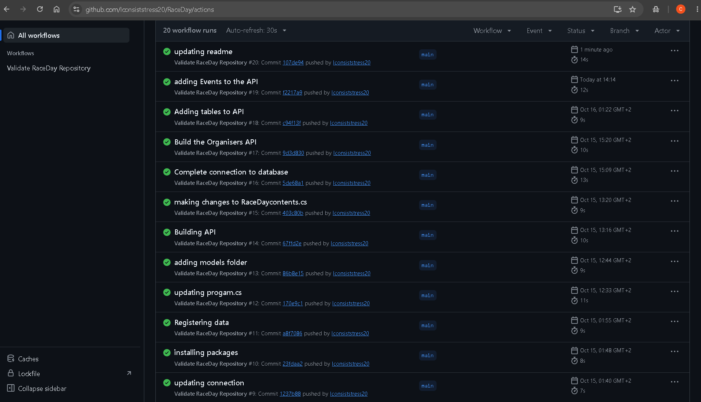

# RaceDay – Race Event Management System

## 1. Project Overview

RaceDay is an ASP.NET Core Web API developed to support race event management. It provides functionality for user registration, login, event management, event enrolments and race results.

The application uses SQL Server to store data and JWT (JSON Web Token) authentication to secure protected endpoints. Swagger is used to document and test the API.

## 2. Technologies Used

- C#
- ASP.NET Core Web API (.NET 10)
- SQL Server
- Entity Framework Core
- JWT Bearer Authentication
- Password hashing
- Swagger / OpenAPI
- Git and GitHub
- GitHub Actions for continuous integration

## 3. User Roles

RaceDay supports two user roles.

### 3.1 Participant

Participants use the system to access functionality associated with their race participation.

Participant functionality includes:

- Registering a participant account.
- Logging in securely.
- Accessing protected endpoints permitted to the Participant role.
- Viewing their own race results through the My Results endpoint.

Participants can only access information and operations permitted by the application's authorization rules.

### 3.2 Organiser

Organisers manage race-related information and operations.

Organiser functionality includes:

- Registering an organiser account and organisation details.
- Logging in securely.
- Accessing organiser-protected API endpoints.
- Managing race-related information where the relevant endpoints are implemented.
- Creating, viewing, updating and deleting race results.

The API uses role-based authorization to restrict organiser-only operations.

## 4. Main Features

- Participant and organiser registration.
- User login and password hashing.
- JWT-based authentication.
- Role-based access control.
- SQL Server database integration.
- Event categories and event environments.
- Event management and enrolments.
- Race result retrieval and management.
- Swagger API documentation and testing.
- GitHub Actions CI workflow for automated validation.

## 5. Database

The application uses a SQL Server database named `RaceDay`.

The database includes the following tables:

- `Users`
- `Participants`
- `Organisers`
- `EventCategories`
- `EventEnvironments`
- `Events`
- `EventEnrollments`
- `Results`

Entity Framework Core is used to access the database through the application's database context.

## 6. Setup Instructions

### 6.1 Prerequisites

Install the following software:

- Visual Studio with the ASP.NET and web development workload.
- .NET 10 SDK.
- SQL Server.
- SQL Server Management Studio (SSMS), or an equivalent SQL Server client.
- Git, if you want to clone the repository.

### 6.2 Obtain the Project


### 6.3 Configure the Database

1. Start SQL Server.
2. Open SQL Server Management Studio.
3. Connect to your SQL Server instance.
4. Confirm that the `RaceDay` database and its required tables exist.
5. Configure the application's SQL Server connection string.

The connection string must match your local SQL Server instance and database.

If the project uses Entity Framework Core migrations, apply the migrations required by the project. If the database was created using SQL scripts, execute the required scripts instead.

### 6.4 Configure Application Secrets

Configure the database connection string and JWT signing key using the application's supported configuration system or .NET User Secrets.

For example, from the project directory:

```bash
dotnet user-secrets init
```

Add the required values using the configuration keys expected by your application.

**Security:** never commit database passwords, JWT signing keys, access tokens or other secrets to GitHub. Do not copy example configuration keys without checking the actual `Program.cs` configuration.

### 6.5 Restore and Build the Project

Open a terminal in the directory containing the API project file (`.csproj`) and run:

```bash
dotnet restore
dotnet build
```

The restore command downloads the required NuGet packages. The build command compiles the project and reports compilation errors, if any.

### 6.6 Run the Application

Run the project from Visual Studio using the green **Start** button, or use:

```bash
dotnet run
```

Open the Swagger URL displayed in the terminal or browser when the application starts.

For example:

```text
https://localhost:5180/swagger
```

Replace `YOUR_PORT` with the actual port configured for your application.

## 7. Authentication and API Usage

### 7.1 Register an Account

Use the appropriate registration endpoint in Swagger to create a participant or organiser account.

For organiser registration, provide the required personal details and organisation information.

### 7.2 Log In

Use:

`POST /api/Users/login`

Submit the email and password for the registered account.

When login succeeds, the API returns a JWT access token.

### 7.3 Authorize Requests in Swagger

1. Log in and obtain a fresh JWT token.
2. Click **Authorize** in Swagger.
3. Enter the token in the format expected by the configured Bearer authentication scheme.
4. Click **Authorize**, then close the dialog.
5. Execute the protected endpoints allowed for that role.

Expired tokens must be replaced by logging in again.

### 7.4 Results Endpoints

The results functionality includes:

- `GET /api/Results` — retrieve results as an organiser.
- `GET /api/Results/my-results` — retrieve results associated with the authenticated participant.
- `POST /api/Results` — create a result for an existing enrolment.
- `PUT /api/Results/{id}` — update an existing result.
- `DELETE /api/Results/{id}` — delete an existing result.

The create endpoint checks that the enrolment exists and prevents duplicate results for the same enrolment.

## 8. CI/CD – Continuous Integration

RaceDay uses GitHub Actions to automate project validation when changes are pushed to the repository or a pull request is opened, according to the configured workflow triggers.

The CI workflow should:

1. Check out the repository.
2. Set up the required .NET SDK.
3. Restore project dependencies.
4. Build the application.
5. Run the automated tests, if a test project is configured.

### 8.1 CI/CD Workflow Screenshot

The screenshot below should show the actual result of the RaceDay GitHub Actions workflow.




*Figure 1: RaceDay GitHub Actions workflow showing the build and test results.*


## 9. Demonstration Video

The project demonstration video presents the RaceDay application, its main features, and the API testing process.

**YouTube video:** [Watch the RaceDay Part 2 demonstration](https://youtu.be/zI2JAPMTP-U)


## 10. Testing

Swagger can be used to test the API endpoints and inspect HTTP responses.

Recommended checks include:

- Participant registration and login.
- Organiser registration and login.
- Authorized access to protected endpoints.
- Rejection of expired or invalid tokens.
- Retrieval of event enrolments and results.
- Creation of a result for a valid enrolment.
- Rejection of duplicate results.
- Updating and deleting a test result.
- Participant access to their own results.
- Successful CI build and configured automated tests.

## 11. Security Considerations

- Passwords must be stored as hashes rather than plain text.
- JWT signing keys and database credentials must not be committed to source control.
- Protected endpoints must require valid authentication.
- Role-based authorization must restrict access to the appropriate operations.
- Demonstration videos and screenshots must not expose passwords, tokens or secret keys.

## 12. Project Status

RaceDay includes a database-backed ASP.NET Core API, participant and organiser account functionality, JWT authentication, role-based authorization, and race result operations.

Before submission, verify that the README setup instructions match the repository, that the CI/CD screenshot shows the real workflow result, that the YouTube link works, and that the required endpoint and automated tests have been completed.